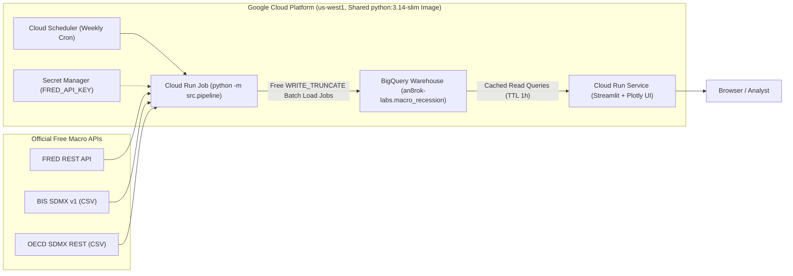

# Global Macro Recession Predictor

> **Live Dashboard:** [https://macro-recession-predictor-371024701820.us-west1.run.app](https://macro-recession-predictor-371024701820.us-west1.run.app)

An institutional-grade, zero-leakage macroeconomic recession and growth-cycle risk monitor spanning **US, Euro Area (EA20), Japan, China, India, and a GDP-weighted Global composite** across 5 forecast horizons (`0M`, `3M`, `6M`, `12M`, `18M`). Engineered as a decoupled batch-ETL and read-only analytics stack on Google Cloud (`us-west1`) using official free macro APIs (**FRED**, **BIS SDMX**, **OECD SDMX**) and BigQuery batch load jobs to operate within Google Cloud Always Free tiers.

---

## Architecture & $0 GCP Stack

A single lean `python:3.14-slim` container image ([Dockerfile](Dockerfile)) powers both the scheduled ETL **Cloud Run Job** (`python -m src.pipeline`) and the stateless **Cloud Run Service** (`streamlit run main.py`). Co-locating Cloud Run and BigQuery in `us-west1`, authenticating FRED via **Secret Manager**, loading tables strictly via free `WRITE_TRUNCATE` batch load jobs (never paid streaming inserts), and caching dashboard queries (`@st.cache_data(ttl=3600)`) keeps operating costs at **$0/month** with zero API calls or model training on page load.



---

## Methodology: Option A Hybrid Targets & Zero-Leakage Design

### Multi-Region Coverage & Feature Pillars

| Region | Economy | Target Definition (Option A Hybrid) | Embargo / OOS Start | Active Feature Pillars |
| :--- | :--- | :--- | :---: | :--- |
| **`GLOBAL`** | Global Composite | GDP-weighted composite (`US 40%`, `CN 26%`, `EU 22%`, `JP 6%`, `IN 6%`), dynamically re-normalized pre-2010 | — / `1975` | Weighted composite of constituent regional curves + regional risk attribution |
| **`US`** | United States | Classical Recession — NBER (`FRED:USREC`) | `t + h` / `1975` | 12 features: 10Y–3M curve & 3M MA, Fed Funds level & 12M chg, Baa–10Y credit spread & 6M chg, CPI YoY & 3M ann., IndPro YoY & 6M, Sahm Rule, Payrolls YoY |
| **`EU`** | Euro Area (EA20) | Technical Recession — ≥2 consecutive negative QoQ Real GDP quarters (`FRED:CLV10MEURB1GQSCAEA20Q`) | `t + h + 3` / `2010` | 11 features: 10Y–3M spread & 3M MA, ECB policy level & 12M chg, CPI YoY & 3M ann., EA20 equity 12M return & drawdown, REER 12M chg, OECD CLI (`G4E`) level & 6M chg |
| **`JP`** | Japan | Technical Recession — ≥2 consecutive negative QoQ Real GDP quarters (`FRED:JPNRGDPEXP`) | `t + h + 3` / `2005` | 11 features: 10Y–Policy spread & 3M MA, BoJ policy level & 12M chg, CPI YoY & 3M ann., equity 12M return & drawdown, REER 12M chg, OECD CLI (`JPN`) level & 6M chg |
| **`CN`** | China | Growth-Cycle Downturn — OECD CLI < `99.5` (`OECD:DF_CLI:CHN`) | `t + h` / `2008` | 9 features: 3M–Policy spread & 3M MA, PBoC policy level & 12M chg, CPI YoY & 3M ann., equity 12M return & drawdown, REER 12M chg *(CLI excluded)* |
| **`IN`** | India | Growth-Cycle Downturn — OECD CLI < `99.5` (`OECD:DF_CLI:IND`) | `t + h` / `2005` | 9 features: Real Policy Rate (`Policy − CPI YoY`) & 3M MA, RBI policy level & 12M chg, CPI YoY & 3M ann., equity 12M return & drawdown, REER 12M chg *(CLI excluded)* |

### Anti-Leakage Safeguards
- **Point-in-Time Publication Lags:** Market yields, policy rates, and equity indices carry a `0M` lag; macro releases (`CPI`, `INDPRO`, `UNRATE`, `PAYEMS`, `REER`, `OECD CLI`) are shifted `+1M` *after* computing YoY/rolling transforms so features at `as_of_date = t` reflect only prints genuinely available by month-end `t`.
- **Expanding-Window Walk-Forward Embargo:** Out-of-sample scoring at `t_eval` trains strictly on rows satisfying `t_train + h <= t_eval` (and `t_train < t_eval`) for `US`, `CN`, `IN`, and **`t_train + h + 3 <= t_eval`** for `EU` and `JP` to enforce a 1-quarter GDP publication settlement and 2-quarter contraction confirmation buffer. `StandardScaler` is fit strictly inside every training window.
- **Target Tautology Guard:** For `CN` and `IN` (where `OECD CLI < 99.5` defines the target), `cli_level_dev` and `cli_6m_chg` are forced `NULL` and excluded from training so models predict downturns purely from monetary, inflation, equity, and FX signals.
- **Per-Region L2 Regularization & Benchmark:** Primary calibrated `logistic_l2` uses `C=0.50` for deep US history (70+ years) and tighter `C=0.05` for `EU`, `JP`, `CN`, and `IN` to curb small-sample overfitting in early expanding windows (quarterly refits), benchmarked against a shallow `random_forest` (`max_depth=4`, `min_samples_leaf=10`, annual refits).

---

## Real-World Data Engineering Highlights

1. **October 2025 US Federal Government Shutdown Gap (`CPIAUCSL` / `UNRATE`):** FRED has no October 2025 observation for `CPIAUCSL` or `UNRATE`, which naively cascades `NaN`s through `UNRATE`'s 3-month mean and 12-month Sahm Rule minimum and drops all of 2026. Applying strictly causal `.ffill(limit=1)` on raw monthly feature series *before* rolling/YoY transforms (never linear interpolation, never forward-filling `USREC`) carries the September 2025 print forward by one month with zero look-ahead and preserves full live 2026 coverage.
2. **Bank of Japan ZIRP/QE/QQE Monetary-Base Windows (`BIS:WS_CBPOL/M.JP`, 1999–2016):** BIS intentionally leaves `WS_CBPOL/M.JP` blank during periods when the BoJ targeted current-account balances/monetary base rather than an explicit call-rate target (`116` missing months). Applying a targeted, strictly causal `.ffill()` exclusively to `BIS:WS_CBPOL/M.JP` (after its first valid print) bridges those regimes cleanly, restoring uninterrupted `1995–2026` Japanese history (`381` monthly rows) while keeping all other series bounded at `.ffill(limit=1)`.

---

## Out-of-Sample Validation Snapshot

Strictly out-of-sample expanding-window metrics (`1975–2026` US; `2005–2026` JP/IN; `2008–2026` CN; `2010–2026` EU) from the latest production pipeline run (`as_of_date = 2026-10-31`):

| Region | Horizon | `logistic_l2` ROC-AUC | `logistic_l2` Brier | `random_forest` ROC-AUC | `random_forest` Brier | OOS Months | Base Rate |
| :--- | :---: | ---: | ---: | ---: | ---: | ---: | ---: |
| **US** | `0M` | 0.913 | 0.059 | 0.936 | 0.060 | 622 | 0.098 |
| **US** | `3M` | 0.792 | 0.089 | 0.786 | 0.087 | 619 | 0.094 |
| **US** | `6M` | 0.687 | 0.099 | 0.714 | 0.092 | 616 | 0.094 |
| **US** | `12M` | 0.678 | 0.091 | 0.747 | 0.088 | 610 | 0.095 |
| **EU** | `0M` | 0.805 | 0.134 | 0.713 | 0.125 | 201 | 0.164 |
| **EU** | `3M` | 0.655 | 0.164 | 0.649 | 0.137 | 198 | 0.167 |
| **EU** | `6M` | 0.511 | 0.182 | 0.674 | 0.149 | 195 | 0.169 |
| **EU** | `12M` | 0.359 | 0.216 | 0.623 | 0.161 | 189 | 0.175 |
| **JP** | `0M` | 0.626 | 0.124 | 0.668 | 0.122 | 261 | 0.138 |
| **JP** | `3M` | 0.567 | 0.144 | 0.615 | 0.137 | 258 | 0.140 |
| **JP** | `6M` | 0.579 | 0.137 | 0.661 | 0.125 | 255 | 0.141 |
| **JP** | `12M` | 0.548 | 0.128 | 0.292 | 0.159 | 249 | 0.145 |
| **CN** | `0M` | 0.781 | 0.169 | 0.675 | 0.203 | 226 | 0.323 |
| **CN** | `3M` | 0.642 | 0.210 | 0.580 | 0.233 | 223 | 0.327 |
| **CN** | `12M` | 0.433 | 0.257 | 0.564 | 0.233 | 214 | 0.304 |
| **IN** | `0M` | 0.552 | 0.253 | 0.581 | 0.242 | 262 | 0.359 |
| **IN** | `18M` | 0.537 | 0.251 | 0.518 | 0.247 | 244 | 0.340 |

*Honest OOS Interpretation:* Predictability is strongest at `0M–3M` nowcasting/near-term horizons across `US`, `EU`, `JP`, and `CN` (and `12M` yield-curve signal in `US`), and naturally decays at `12M–18M` as exogenous shocks (e.g., 2020 COVID lockdowns, 2022 European energy shock) dominate long-horizon macro forecasts. Tightening international L2 regularization to `C=0.05` materially improved out-of-sample probability calibration (lower Brier Scores across `EU`, `JP`, `CN`, and `IN`), while `random_forest` provides useful nonlinear robustness in shorter non-US samples (`EU 6M–12M`, `JP 0M–6M`).

---

## Local Setup & Verification

### 1. Create Virtual Environment & Install Dependencies
```bash
python -m venv .venv

# Windows (PowerShell)
.\.venv\Scripts\pip.exe install -r requirements.txt

# macOS / Linux
source .venv/bin/activate && pip install -r requirements.txt
```

### 2. Configure Credentials
Create a `.env` file in the repository root (git-ignored) with your FRED API key and authenticate Google Cloud Application Default Credentials (ADC) for BigQuery:
```bash
echo "FRED_API_KEY=your_fred_api_key_here" > .env
gcloud auth application-default login
```

### 3. Run Offline Unit, Math & Zero-Leakage Verification
Runs all 8 synthetic tests (12-feature math, 1M publication-lag invariance, Oct-2025 mid-series gap recovery, 2Q GDP & `CLI < 99.5` target labelers, EU/JP `+3M` embargo perturbation proof, Global weight re-normalization, and static BigQuery batch-load guard):
```bash
python tests/verify_pipeline.py
```

### 4. Execute Batch ETL Pipeline & Live BigQuery Smoke Check
```bash
python -m src.pipeline
python tests/verify_pipeline.py --bq-smoke
```

### 5. Launch the Dashboard Locally
```bash
streamlit run main.py
```

---

## Repository Structure

```text
macro-recession-predictor/
├── main.py                     # Stateless Streamlit + Plotly dashboard (4 tabs, GLOBAL + 5 economies)
├── Dockerfile                  # Shared python:3.14-slim image for Cloud Run Service & Cloud Run Job
├── .gcloudignore               # Excludes .venv, .env, tests, docs, and local caches from Cloud Build
├── requirements.txt            # Lean Python 3.14-compatible dependencies
├── docs/
│   └── ARCHITECTURE.md         # Detailed Phase 2 technical specification, schemas, and series catalog
├── src/
│   ├── config.py               # GCP/BQ config, RegionSpec registry, feature sets, GDP weights
│   ├── ingest.py               # Retry-safe REST/CSV fetchers for FRED, BIS SDMX, and OECD SDMX
│   ├── features.py             # Option A target labelers, causal ffill, and point-in-time macro features
│   ├── modeling.py             # Expanding-window walk-forward ML, embargo masks, GLOBAL composite
│   ├── warehouse.py            # BigQuery dataset init, WRITE_TRUNCATE batch loads, cached read queries
│   ├── pipeline.py             # CLI entrypoint (`python -m src.pipeline`)
│   └── charts.py               # Dark/light-compatible Plotly figure builders
└── tests/
    └── verify_pipeline.py      # Offline unit/math/zero-leakage suite + live `--bq-smoke` verifier
```
